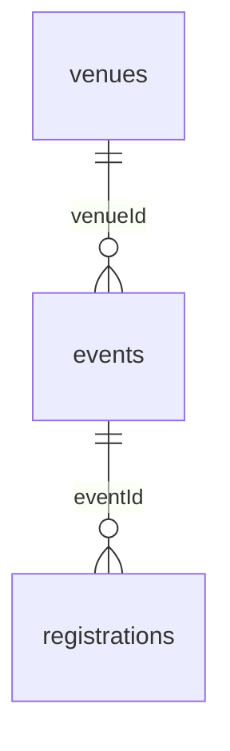

# Datamodel — dokumentation og verifikation

Dokumenteret efterfølgende 15. oktober 2026. Oprindelig implementering: `cd0ea64`; relationel frontend: `b534398`. Databasens tidligere tilstand er ikke genskabt i denne kontrol.

## Problem og konsekvens

Startprojektet gentager stedets navn og adresse på events og eventoplysninger på tilmeldinger. En rettelse skal derfor foretages flere steder og kan give modstridende oplysninger. Startprojektet gemmer heller ikke nye tilmeldinger.

## Eksisterende løsning

Der er tilføjet en venues-tabel, events.venueId og registrations.eventId. Frontenden henter sted via events og eventdata via registrations i relationelle REST-kald.

Diagrammet viser den tilsigtede relation: ét venue kan have flere events, og ét event kan have flere tilmeldinger. SQL-filen tillader aktuelt NULL i fremmednøglerne; obligatorisk tilknytning er derfor endnu ikke dokumenteret som håndhævet i databasen.

## Verifikation udført 15. oktober 2026

Læsninger mod projektets eksisterende Supabase REST API med publishable key. Ingen databaseændringer, ingen nye testtilmeldinger.

| Kald | Observeret resultat |
|---|---|
| `/events?select=id,venueId,venue:venues(id)&order=id` | 9 events; alle har venueId og et relateret venue med samme id |
| `/registrations?select=id,eventId,event:events(id)&order=id` | 3 tilmeldinger; alle har eventId og et relateret event med samme id |
| `/venues?select=id&order=id` | 7 venues |
| API-root `/` | 401: endpoint kræver secret key; skemainspektion via denne vej kunne ikke gennemføres |

Rå resultater: `datamodel-api-check.json`. Kun id'er og relationer er hentet for tilmeldinger. Der er ikke behov for at dele en secret key; SQL-kontrollen udføres i projektets SQL Editor.

Dette viser fungerende relationelle læsninger for de eksisterende data. Det dokumenterer ikke POST-flow, alle databaseconstraints eller deployment.

## Resterende kontrol før færdiggørelse

Kør `supabase/checks/datamodel-audit.sql` i Supabase SQL Editor og gem alle tre resultatsæt. Forespørgslen læser kun skema og antal; den ændrer intet.

1. Kontrollér de faktiske felter og hvilke der tillader NULL.
2. Kontrollér fremmednøgler og øvrige constraints.
3. Kontrollér manglende og brudte relationer (forventet 0).
4. Beslut og dokumentér migration af gamle kopifelter og obligatorisk eventId, når skemaet er kendt. Fjern ikke gamle felter uden kontrol af data og afhængigheder.

Den nuværende starter.sql beholder gamle kopifelter. Normaliseringen er derfor kun delvis. Filen indeholder også upserts af startdata og bør ikke køres blindt mod den eksisterende database.

## Forventet værdi

Fælles venue- og eventdata kan reducere dobbeltvedligeholdelse og modstridende oplysninger. Det er en fagligt begrundet forventning; faktisk tidsbesparelse og effekt på brugernes tilmeldinger er ikke målt.
