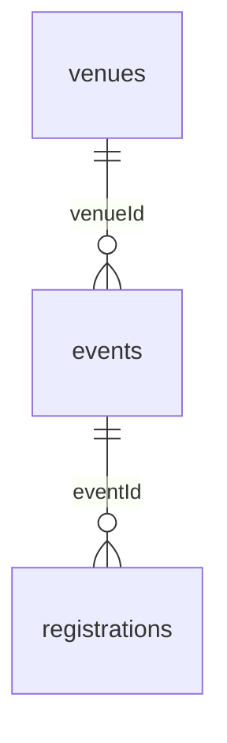

# Datamodel — dokumentation og verifikation

Dokumenteret efterfølgende 15. oktober 2026. Oprindelig implementering: `cd0ea64`; relationel frontend: `b534398`. Databasens tidligere tilstand er ikke genskabt i denne kontrol.

## Problem og konsekvens

Startprojektet gentager stedets navn og adresse på events og eventoplysninger på tilmeldinger. En rettelse skal derfor foretages flere steder og kan give modstridende oplysninger. Startprojektet gemmer heller ikke nye tilmeldinger.

## Eksisterende løsning

Der er tilføjet en venues-tabel, events.venueId og registrations.eventId. Frontenden henter sted via events og eventdata via registrations i relationelle REST-kald.

Diagrammet viser den tilsigtede relation: ét venue kan have flere events, og ét event kan have flere tilmeldinger. Kontrollen før rettelsen viste nullable fremmednøgler. Mikkel har derefter gjort registrations.eventId obligatorisk og verificeret is_nullable = NO. Venue er fortsat valgfrit; frontenden har en fallback for manglende sted.

## Verifikation udført 15. oktober 2026

Læsninger mod projektets eksisterende Supabase REST API med publishable key. Ingen databaseændringer, ingen nye testtilmeldinger.

| Kald | Observeret resultat |
|---|---|
| `/events?select=id,venueId,venue:venues(id)&order=id` | 9 events; alle har venueId og et relateret venue med samme id |
| `/registrations?select=id,eventId,event:events(id)&order=id` | 3 tilmeldinger; alle har eventId og et relateret event med samme id |
| `/venues?select=id&order=id` | 7 venues |
| API-root `/` | 401: endpoint kræver secret key; skemainspektion via denne vej kunne ikke gennemføres |

Rå resultater: `datamodel-api-check.json`. Kun id'er og relationer er hentet for tilmeldinger. Der er ikke behov for at dele en secret key; SQL-kontrollen udføres i projektets SQL Editor.

Dette viser fungerende relationelle læsninger for de eksisterende data. Det dokumenterer ikke POST-flow, alle databaseconstraints eller deployment.

## Kontrolmetode

Filen `supabase/checks/datamodel-audit.sql` er en read-only kontrol til Supabase SQL Editor. Den læser skema, constraints, rækkeantal og brudte relationer; den ændrer intet. De dokumenterede SQL Editor-resultater er gengivet i afsnittene nedenfor.

1. Kontrollér de faktiske felter og hvilke der tillader NULL.
2. Kontrollér fremmednøgler og øvrige constraints.
3. Kontrollér manglende og brudte relationer (forventet 0).
4. Brug migrationsfilerne til den eksisterende database og `starter.sql` kun til en frisk database. Migration 002 er efterfølgende kørt og kontrolleret; `starter.sql` er ikke afprøvet i en tom PostgreSQL-database.

## Forventet værdi

Fælles venue- og eventdata kan reducere dobbeltvedligeholdelse og modstridende oplysninger. Det er en fagligt begrundet forventning; faktisk tidsbesparelse og effekt på brugernes tilmeldinger er ikke målt.

## SQL Editor-resultater og færdiggørelse

Mikkel leverede følgende faktiske resultater i samtalen den 15. oktober 2026:

- Begge fremmednøgler er oprettet: events_venueId_fkey og registrations_eventId_fkey.
- Alle tre tabeller har PRIMARY KEY (id).
- Events uden venue: 0. Tilmeldinger uden event: 0.
- NOT NULL på registrations.eventId er kørt og verificeret: is_nullable = NO.
- Sammenligning af samtlige fem gamle venuefelter med venues: 0 rækker med forskelle.
- Sammenligning af udfyldte gamle eventfelter på tilmeldinger med events/venues: 0 rækker med forskelle.

Den udførte NOT NULL-rettelse er bevaret som migrationsfil 001. Fjernelsen af de otte kopifelter er udført via migration 002 og verificeret. Den nuværende frontend bruger relationerne; søgning i src har ingen referencer til de otte gamle feltnavne.

starter.sql er opdateret til en frisk database med venues → events → registrations, direkte fremmednøgler i seed-data og obligatorisk eventId. Den opdaterede opsætning er endnu ikke afprøvet i en tom PostgreSQL-database. Brug migrationsfilerne til det eksisterende projekt i stedet for at genkøre seed-data.

### Forbedring: obligatorisk eventtilknytning

Problem: en nullable fremmednøgle tillod tilmeldinger uden event. Konsekvens: intern oversigt kunne indeholde en tilmelding uden identificerbart arrangement. Løsning: NOT NULL på eventId, kombineret med den eksisterende fremmednøgle. Verifikation: 0 manglende koblinger før ændringen og is_nullable = NO efter ændringen. Værdi: databasen håndhæver nu obligatorisk tilknytning til et eksisterende event. En faktisk afvist ugyldig INSERT er endnu ikke testet.

## Migration 002 udført og efterkontrolleret

Mikkel kørte migration 002 i SQL Editor 15. oktober 2026. Resultatet fra information_schema.columns bekræfter, at alle otte kopifelter er fjernet og registrations.eventId stadig er NOT NULL. Efterfølgende kontrol: 9 events, 7 venues, 3 tilmeldinger, 9 events med venue via JOIN og 3 tilmeldinger med event via JOIN. Antallene stemmer med førkontrollen. Rækkerne og de kontrollerede relationer er bevaret. Dette erstatter pending-status i de tidligere arbejdsnoter ovenfor.

Faktisk værdi: venueoplysninger lagres nu på venues og eventdata på events; tilmeldinger refererer til events. Modstridende kopier i de fjernede felter kan ikke længere opstå. Brugereffekt og tidsbesparelse er ikke målt. Formularens POST og frontend verificeres separat.
