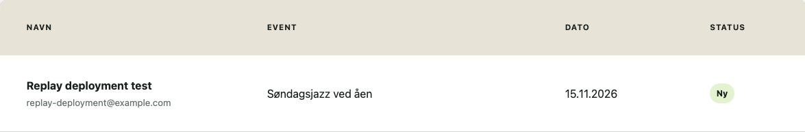

# Mellemrum: fra prototype til gemt tilmelding

Mellemrum er en eventplatform for lokale kulturoplevelser i Aarhus. Udgangspunktet var en React-prototype, hvor brugeren kunne se events og udfylde en formular. Formularen gemte dog ikke tilmeldingen. Arbejdet fokuserede derfor på at få brugerens tilmelding hele vejen fra formularen til databasen og arrangørens oversigt.

## Hvad fungerede ikke før?

Formularen skrev kun brugerens input i konsollen. Ved testen af event 9 blev der ikke sendt nogen POST-request, og databasen havde stadig de samme to tilmeldinger bagefter. Brugerens handling førte altså ikke til en registrering.

Datamodellen gav også unødvendig vedligeholdelse. Stedoplysninger lå direkte på hvert event, og tilmeldinger havde kopier af eventtitel, dato og sted. En rettelse kunne derfor kræve ændringer flere steder. Ved fejl i datahentningen kunne eventsiden desuden blive tom uden en forklaring.

Tilmelding og datamodel blev prioriteret højest. Fejlhåndtering og tilgængelighed skulle understøtte det samme flow. Betaling, login, kapacitetsstyring og et nyt visuelt design indgik ikke.

## Hvad blev ændret, og hvorfor?

### Oplysningerne blev samlet i tre tabeller

Steder ligger nu i `venues`. Hvert event henviser til sit sted med `venueId`, og hver tilmelding henviser til sit event med `eventId`. Eventtilknytningen er obligatorisk, og fremmednøgler forhindrer henvisninger til events, der ikke findes.

Det betyder, at arrangøroversigten kan hente titel og dato fra eventet frem for fra en kopi på tilmeldingen. Relationerne blev oprettet først, frontend blev tilpasset bagefter, og til sidst blev kopifelterne fjernet. På den måde kunne den gamle visning fungere under overgangen.

### Formularen gemmer tilmeldingen

Formularen sender navn, e-mail, status og det valgte event til Supabase. Den kontrollerer input, viser “Tilmelder...” og deaktiverer knappen, mens svaret afventes. Ved succes vises en bekræftelse. Ved fejl får brugeren en forklaring og mulighed for at prøve igen.

Arrangøren kan derefter finde tilmeldingen i oversigten med det rigtige event og den rigtige dato.

### Brugeren får feedback undervejs

Datahentningen håndterer ventetid, fejl, tomme lister og ukendte events. Formularfelterne har etiketter, og oversigten bruger en semantisk tabel med kolonneoverskrifter. Eventsiden nulstilles ved skift af `eventId`, så gammel formularfeedback ikke følger med til et nyt event.

## Hvordan blev det kontrolleret?

Fejl og forsinkelser blev testet lokalt med en isoleret PostgreSQL-database gennem PGlite og en adapter, der efterlignede appens REST-kald. Her kunne svarene styres uden at ændre den offentlige database. Den færdige tilmelding blev også afprøvet separat mod den publicerede løsning og Supabase.

| Kontrol | Resultat |
| --- | --- |
| Migration af den oprindelige database | Ni events, syv steder og to tilmeldinger med korrekte relationer. |
| Tilmelding uden eller med ukendt event-id | Databasen afviste begge dele. |
| Tilmelding til event 9 og genindlæsning | Den nye række blev hentet igen med korrekt event, dato og status. |
| Forsinket formularsvar | Knappen var deaktiveret, mens svaret blev afventet. |
| API-fejl, tom liste og ukendt event | Siden viste de tilhørende beskeder. |
| Eventskift i samme React-session | Tidligere eventindhold og formularfeedback blev nulstillet. |
| Lint, build og publicering | Bestået; den publicerede tilmelding blev efterprøvet. |

Den lokale adapter kontrollerer ikke Supabases adgangsregler eller hele PostgREST. Tastaturflow og semantik blev undersøgt, men en fuld WCAG- og skærmlæsertest er ikke gennemført.

### Eksempel: tilmelding efter genindlæsning

Billedet viser den fiktive testtilmelding hentet fra Supabase i den publicerede oversigt. Det dokumenterer, at tilmeldingen ikke kun blev vist midlertidigt i browseren.

## Hvad viste den efterfølgende Lighthouse-test?

Sammenligningen med den oprindelige prototype afslørede et layoutskift på eventsiden: Footeren blev skubbet ned, når eventdata blev indlæst. Efter en CSS-rettelse faldt CLS fra 0,601 til 0 i tre lokale målinger, og Performance steg fra 56 til 79. LCP lå stadig på cirka 5,8 sekunder.

[Læs forklaringen og se før/efter-resultaterne](../lighthouse/2026-10-15/README.md).

## Resultat og næste skridt

Den centrale forskel er, at tilmeldingen nu bliver gemt og kan findes af arrangøren. Relationerne mindsker behovet for at vedligeholde de samme oplysninger flere steder, og fejl giver ikke længere blot en tom eventside. Det kan mindske frafald og dobbeltarbejde, men der er ikke målt konvertering eller tidsbesparelse.

Den offentlige eventroute returnerer stadig HTTP 404, selvom browseren viser siden gennem GitHub Pages-fallbacken. Det er en uløst publiceringsfejl. Billedoptimering og en fuld skærmlæsertest er også relevante næste skridt.

## Detaljer og dokumentation

Forklaringen ovenfor samler resultaterne. De enkelte ændringer, testbilleder og testopsætningen kan undersøges her:

1. [Datamodel og relationer](01-data-model.md)
2. [Tilmelding og arrangøroverblik](02-registration-flow.md)
3. [Fejlhåndtering og tilgængelighed](03-robustness-accessibility.md)
4. [Nulstilling ved eventskift](04-event-state.md)
5. [Preview, testopsætning og kontrol efter publicering](05-production.md)

### Arbejdsforløb og versioner

Den første implementering var utilstrækkeligt dokumenteret. Kodeændringerne blev derfor gennemført igen fra startkoden den 15. oktober 2026 med en indledende audit og test før hver merge. Erfaringer og løsninger fra første implementering indgik i arbejdet.

Startkoden er `f25fde8`; audit og baseline er `5123b7d`. Baseline-billeder, databasekontrol og netværkslog ligger i `evidence/`. Den lokale frontend brugte port 5190, Node 24.13.0 og Vite 8.2.1 med `npm ci` fra lockfilen. Underviserens offentlige prototype viste også ni events, men dens Git-version er ikke verificeret.

Hver del blev testet på sin feature branch og derefter flettet ind i `case1-replay-main`. Den tidligere historik blev bevaret ved merge til `main`.

| Feature branch | Ændring og test | Merge |
| --- | --- | --- |
| case1-replay-data-model | `71c57c0` | `f9573db` |
| case1-replay-registration-flow | `5b97379` | `e6c2e91` |
| case1-replay-robust-fetch | `928d470` | `7e1f716` |
| case1-replay-event-reset | `dc923a2` | `4a10391` |
| case1-replay-deployment | `4456639` | `8c5eb29` |

Integrationen med den tidligere historik er `c3be5c4`. Før preview-rettelsen var appfilerne identiske med den tidligere løsning; preview-rettelsen ændrede `vite.config.js`.

## Migrationer

`001-add-relations.sql` er beregnet til den oprindelige datamodel i det isolerede testmiljø. Den skal ikke køres på den allerede normaliserede database. Migrationerne køres ikke automatisk ved publicering. Se de enkelte filer og databasekontrollerne før manuel kørsel.
